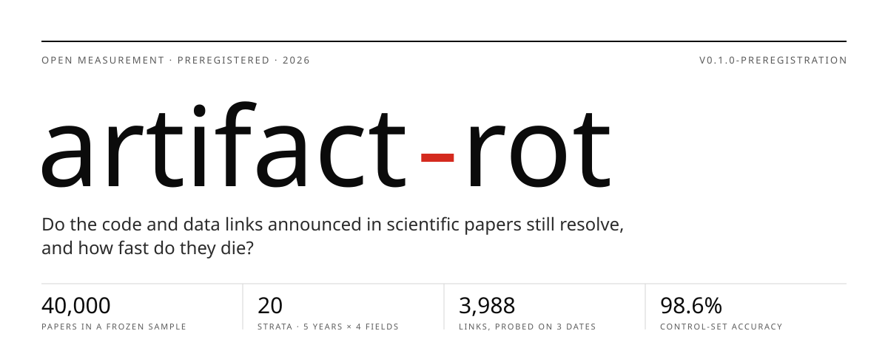
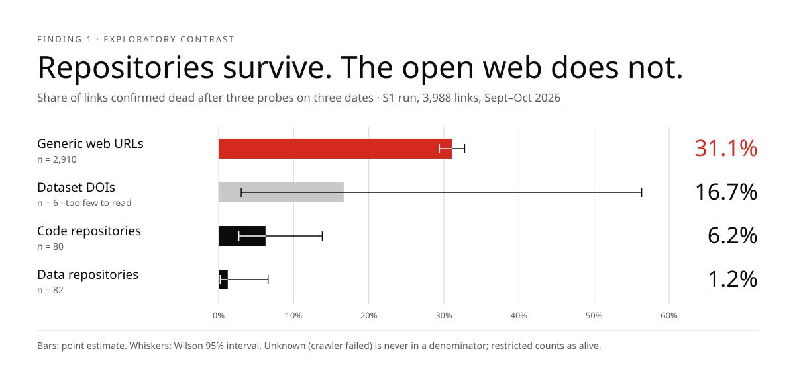
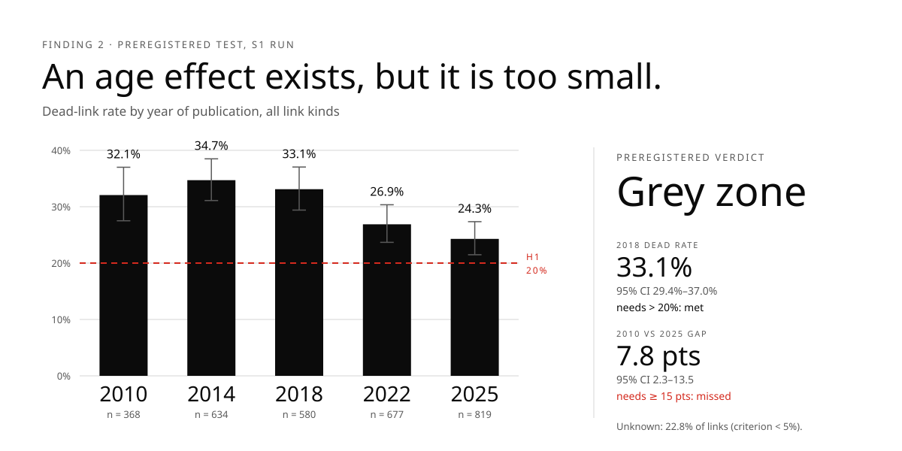
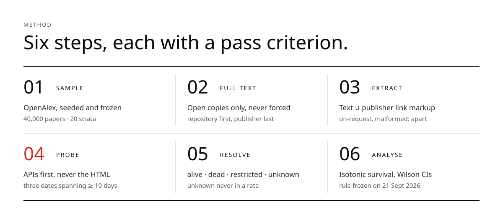
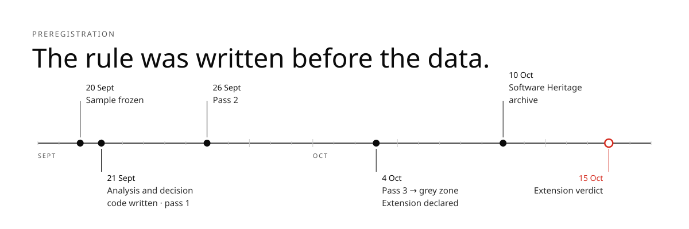

<picture>
  <source media="(prefers-color-scheme: dark)" srcset="docs/figures/hero-dark.svg">
  
</picture>

**artifact-rot** is an open, replayable measurement of whether the links to code and data
announced in scientific papers still resolve. It draws a frozen, stratified sample of
open-access papers, extracts every artifact link from their full text, probes each link
through the host's own API on three separate dates, and fits a survival curve by year of
publication. The decision rule was written and archived before the data it judges.

[Findings](#findings) · [Method](#method) · [Preregistration](#preregistration) ·
[Reproduce](#reproduce) · [Status](#status) · [Cite](#cite)

`Python 3.12` · `257 offline tests` · `MIT` ·
[Software Heritage archive](https://archive.softwareheritage.org/browse/origin/?origin_url=https://github.com/zay168/artifact-rot)

---

## Findings

> [!NOTE]
> The figures below come from the **S1 run**: 2,000 papers, 3,988 links, each probed on 21 Sept,
> 26 Sept and 4 Oct 2026. A threefold extension restricted to code and data repositories is in
> progress; its preregistered verdict is due on **15 October 2026**.

<picture>
  <source media="(prefers-color-scheme: dark)" srcset="docs/figures/by-kind-dark.svg">
  
</picture>

**Where a link points matters more than how old it is.** Almost a third of ordinary web links
cited in papers are gone. Links to code and data repositories (GitHub, GitLab, Zenodo, OSF,
Figshare…) almost all still resolve. This contrast was not the preregistered question. It is
reported as exploratory, and it is what the extension now tests on three times more repository
links.

<picture>
  <source media="(prefers-color-scheme: dark)" srcset="docs/figures/by-year-dark.svg">
  
</picture>

**The preregistered hypothesis H1 was neither confirmed nor refuted.** H1 required two things:
more than 20% of 2018 links dead, *and* a gap of at least 15 points between the oldest and the
newest papers. The first holds with room to spare. The second does not: older papers lose more
links, but only 7.8 points more. That is the grey zone, and the plan allows exactly one response
to it: enlarge the sample once, by a factor of three. The run also missed its own quality
criterion: 22.8% of links stayed `unknown`, mostly because of firewalls and `robots.txt`, against
a target below 5%.

No half-life is published. The survival curve never crosses 50% over fifteen years, and
extrapolating beyond the data would invent the one number everyone would quote.

## Method

<picture>
  <source media="(prefers-color-scheme: dark)" srcset="docs/figures/method-dark.svg">
  
</picture>

| Step | What it does | Pass criterion | Details |
|---|---|---|---|
| **Sample** | 2,000 papers per stratum from OpenAlex, 5 years × 4 fields, fixed seed, frozen on disk with its SHA-256 | replaying the seed gives the same sample | [`docs/sample.md`](docs/sample.md) |
| **Full text** | Open copies only; repository copies before publisher copies; a `403` is never forced | coverage measured per stratum | [`docs/extraction.md`](docs/extraction.md) |
| **Extract** | Union of text extraction and the publisher's own link markup (PDF annotations, JATS `ext-link`) | recall measured against markup | [`docs/extraction.md`](docs/extraction.md) |
| **Probe** | The host's API first (GitHub, GitLab, Bitbucket, Zenodo, OSF, Figshare, DOI Handle), generic HTTP with soft-404 detection last | ≥ 98% on a control set built by construction | [`docs/control-set.md`](docs/control-set.md) |
| **Resolve** | Three probes per link, persistent queue, per-host rate limits | full dry run, no quota exceeded | [`docs/scheduler.md`](docs/scheduler.md) |
| **Analyse** | Isotonic survival by age, Wilson and Newcombe intervals, verdict function | validated on synthetic data before any real number | [`docs/analysis.md`](docs/analysis.md) |

### The four states of a link

| State | Meaning | In the published rate? |
|---|---|---|
| `alive` | resolves, at least once | yes |
| `dead` | non-existence positively confirmed, **three times, on three dates spanning at least ten days** | yes |
| `restricted` | exists, but access is controlled (embargo, private, legal takedown) | yes, counted as alive; a variant excluding it is published alongside |
| `unknown` | the crawler failed: timeout, firewall, `robots.txt` | **never**: counted and reported separately |

Turning a crawl failure into a dead link would be falsification. It is the one error that would
destroy the project, so the resolution rule is a pure, named, tested function
([`artifact_rot/resolve.py`](artifact_rot/resolve.py),
[`tests/test_resolve.py`](tests/test_resolve.py)), and every result records which rule produced
it.

Two populations are kept apart from the start and never added to the dead count:

- **"Available on request"** is not a link. It is counted, never probed.
- **Broken at publication** (truncated TLD, missing repository path) never worked, so it cannot
  have died. It measures editorial control, not rot.

## Preregistration

<picture>
  <source media="(prefers-color-scheme: dark)" srcset="docs/figures/timeline-dark.svg">
  
</picture>

The analysis, the thresholds and the verdict function were committed on 21 September 2026,
before the second probe of any link. The extension and its unchanged criterion were declared on
4 October, before its sample was harvested. The whole repository was archived by
[Software Heritage](https://archive.softwareheritage.org/) on **10 October 2026 at 16:54 UTC**,
five days before the extension verdict.

The preregistration documents were written in French. Their original text is identified by its
git content hash, identical in the Software Heritage archive and in this repository's history:

| Document | Written | Git blob of the French original |
|---|---|---|
| Analysis plan (`docs/analyse.md`, now [`docs/analysis.md`](docs/analysis.md)) | 2026-09-21 | `e8ab190ca9070089ed6bef267ce3d4a38ea86091` |
| Extension plan (`docs/prolongation.md`, now [`docs/extension.md`](docs/extension.md)) | 2026-10-04 | `60250bdf4e304483d9f9c14656a0e4a5b87f05eb` |
| Decision code ([`artifact_rot/survival.py`](artifact_rot/survival.py)) | 2026-09-21 | `7d1e63ef152c8151f3ea6d85e62266e7aa0b0b4e` |

To check one: `git cat-file -p <hash>`. The English files are translations. Where they differ,
the French originals prevail.

**Stopping rule.** If H1 is refuted, the positive result ("links survive") is published as such
and the project stops. There is no maintenance out of inertia, and no second enlargement.

## What it measures, and what it does not

It measures **HTTP responses and identifier resolutions**, nothing else.

| Measured | Never claimed |
|---|---|
| "On 4 October 2026, this link does not resolve." | "These authors did not share their data." |
| Rates by year, field, host and kind of link | Anything about an individual researcher |

A link can die because a university migrated its servers or a repository was renamed. The
report says so and measures anyway: for a reader trying to reproduce the work, the outcome is the
same. **No author is ever named.** Aggregates describe institutions, which have policies.

## Reproduce

```bash
uv venv --python 3.12
uv pip install -e ".[dev]"
uv run pytest                                      # 257 offline tests, ~1 s

export ARTIFACT_ROT_CONTACT="you@example.org"      # mandatory: hosts must be able to reach you
export GITHUB_TOKEN="$(gh auth token)"             # optional: 60 -> 5,000 requests/hour

uv run python -m artifact_rot.sample verify        # integrity and drift of the frozen sample
uv run python -m artifact_rot.control              # E2 control set, real network
uv run python -m artifact_rot.schedule status      # queue state, links due now
uv run python -m artifact_rot.schedule run         # one probing pass (resumable)
uv run python -m artifact_rot.verdict artifacts    # H1 verdict on the current queue
```

The README figures are generated from the S1 verdict by
[`tools/readme_figures.py`](tools/readme_figures.py).

<details>
<summary><strong>Repository layout</strong></summary>

```
artifact_rot/
  sample.py         E1  stratified OpenAlex sample, frozen with a manifest
  fulltext.py       E3  open full-text retrieval, atomic cache
  extract/              link extraction, normalisation, availability statements
  probe/            E2  one prober per host family; generic HTTP last
  control.py        E2  control set with ground truth built by construction
  schedule.py       E4  SQLite queue, three passes, per-host rate limiter
  resolve.py            the resolution rule: three probes -> one state
  survival.py       E6  isotonic survival, Wilson intervals, H1 verdict
  verdict.py        E6  applies survival.py to the queue
docs/                   one document per stage, plus related work
tests/                  offline test suite, one file per module
tools/                  README figures
```

</details>

## Good network citizenship

`robots.txt` is respected and no protection is ever bypassed. Every host has its own hourly
budget, set well below its published limit: 2,000 requests/hour for GitHub's 5,000, a quarter of
Zenodo's anonymous limit. Hosts are probed concurrently, so a slow server delays nobody but
itself. A link already seen alive is never probed again. The `User-Agent` carries the project URL
and a reachable contact. If a host asks us to stop, we stop and say so in the report.

## Related work and reuse

[`scienceverse/metacheck`](https://github.com/scienceverse/metacheck) (R, AGPL-3.0) already
checks repository links in papers. Its code cannot be reused here, for reasons of language and
licence. Its **failure modes measured on 1,861 papers** can, and they are worth more than code:
URLs split by GROBID, the references section excluded by default, an uncovered Figshare pattern.
All three are named regression tests in [`tests/test_normalize.py`](tests/test_normalize.py).
Data-sharing detection follows the published method of
[ODDPub](https://doi.org/10.5334/dsj-2020-042) (CC BY 4.0), not its code.

This repository's own contribution:

- existence probes through each host's API, each with a named classification reason;
- the separation of `restricted` from `unknown`;
- "dead" versus "never existed", told apart through Software Heritage;
- a control set whose ground truth is built, not annotated.

Full survey: [`docs/related-work.md`](docs/related-work.md).

## Status

| Stage | Result |
|---|---|
| E0 · Related work | done: no continuous, replayable observatory of this kind exists |
| E1 · Frozen sample | passed 2026-09-20: 40,000 papers, 20 strata, Jaccard 1.0 on replay |
| E2 · Probes | passed 2026-09-20: 139 of 141 control cases (98.6%), threshold 98% |
| E3 · Extraction | measured: text recall 0.495, hence the union with publisher markup |
| E4 · Scheduler | passed: full dry run of 2,363 links, no quota exceeded |
| E5 · S1 run | three passes done on 3,988 links; verdict **grey zone**; `unknown` 22.8% (criterion < 5%) |
| Extension ×3 | in progress on code and data repositories; verdict **2026-10-15** |
| E6 · Analysis | written and validated on 2026-09-21, before any real number |
| E7 · Decision | after the extension verdict |

No stage starts before the previous one meets its criterion. The full plan is in
[`PLAN.md`](PLAN.md).

## Cite

```bibtex
@software{alsarraf_artifact_rot_2026,
  author  = {Al Sarraf, Zayd},
  title   = {artifact-rot: an observatory of the survival of code and data links
             announced in scientific papers},
  year    = {2026},
  version = {0.1.0-preregistration},
  url     = {https://github.com/zay168/artifact-rot}
}
```

Machine-readable metadata: [`CITATION.cff`](CITATION.cff).

## Licence

Code under the [MIT licence](LICENSE). The figures embed subsets of Bodoni Moda and Hanken
Grotesk, both under the SIL Open Font License.
